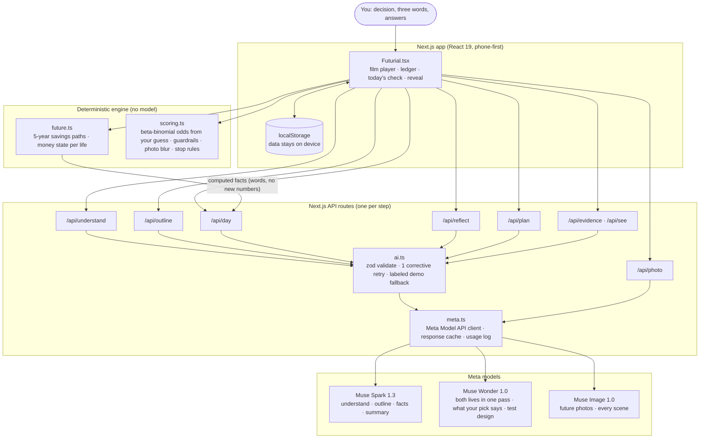

# Futurial

> Try before you ~~buy~~ life.

**The biggest decisions in life are the ones you can't try first.** A new job, a move, caring for a parent: pros-and-cons lists go in circles, chatbots give opinions, and the people we love live with the result.

Futurial lets you **live five years ahead in both futures before you choose**, then gives you **one real thing to do today** to find out what you don't know yet. It never picks an answer for you.

Built for the **Meta Global AI Developer Hackathon** (theme: *Build for Your World*) with **Muse Spark**, **Muse Wonder**, and **Muse Image**.

---

## What it does

1. **It learns your life.** You say your decision the way you'd tell a friend, write the first three words that come up ("guilt, growth, kids"), and answer a few tailored questions: who you're doing this for, your savings, your hours.
2. **It computes five years ahead.** Code projects savings month by month in both lives from your numbers and labeled guesses (pay change, income, prices). The model never makes these numbers.
3. **You live both futures, like a short film.** Each life opens on a title card: where it most likely stands, plus what it looks like if it goes well or badly, labeled as a guess. Then three scenes of one week, each a full-screen picture with subtitles and one line someone says:
   - **the scene you were afraid of** (in the life that stays, the fear of staying),
   - **a real choice** you make yourself,
   - **the people you're doing this for**, on the weekend.
4. **Both lives, plainly.** Money (computed), what each life gave and cost you, how often your three words came back.
5. **"Which life's hard part could you live with?"** Not which life is better. Your pick comes back as one condition: *"You'd carry tight money over the same work, as long as …"*
6. **One check for today.** That condition becomes a 20-minute check: who to ask, where to find them, a message to copy. You write your guess first; code tells you how likely a small sample is to mislead you.
7. **The reveal.** You log what people said. The blurry photo of that future develops only as far as the evidence goes, and your guess gets its stamp. You decide.

---

## Architecture



**The rule of the system:** the model builds structure and words, code computes every number, and you own your beliefs. The model never outputs a probability or a dollar amount you didn't give it.

### Where each model does its work

| Step | Model | Reasoning effort | What it returns |
|---|---|---|---|
| Understand your decision, tailored questions | Muse Spark 1.3 | low | options, what the decision depends on, up to 3 questions with tap answers |
| Outline of the week (shown while the lives are written) | Muse Spark 1.3 | minimal | 3 days and what differs |
| **Both lives, in one call** | **Muse Wonder 1.0** | low | per life: headline, most likely / if well / if badly, what it gave, what it cost, its hard part; 3 days × 2 lives of scenes with a voice line, your words touched, and one choice |
| Scene pictures and future photos | Muse Image 1.0 | — | first-person instant-film photos, no faces or text |
| What your pick says + today's check | Muse Wonder 1.0 | low | "You'd carry X over Y, as long as Z." and a check that tests Z for the life you picked |
| Other tests | Muse Wonder 1.0 | medium | candidates; **code** ranks them and drops irreversible or high-risk ones |
| Facts from your notes, one-line summary | Muse Spark 1.3 | minimal | counts and quotes only from what you wrote |

### Why Muse Wonder writes both lives in one call

Writing the two lives together lets every scene contrast with its twin on the same day: same shared events (a slow freelance month, a surprise bill), handled differently by each household's **computed** money state. Code decides whether a life is *comfortable*, *tight*, or *short*; the model only shows it. Automated checks fail any pair of scenes that differ only by a number.

---

## Design principles

- **Numbers come from code.** Five-year savings (`engine/future.ts`), odds from your own guess (beta-binomial, `engine/scoring.ts`), photo blur from evidence strength. Prompts forbid invented amounts; evals check it.
- **Fair comparison.** Pressures that don't depend on the choice happen in both lives. Both lives get an honest hard part, and the safe path has real costs too.
- **Labeled honestly.** Guesses say *guess*, computed values say *computed*, hypothetical scenes say so. Imagined days never count as evidence.
- **Only what you gave.** Tap-answer ranges stay in words; messages to strangers carry no private details.
- **Safe by default.** Irreversible or high-risk tests are filtered by deterministic rules after generation. Crisis messages are handed off to a crisis line instead of analyzed.

---

## Tech stack

| Layer | What we use |
|---|---|
| App | Next.js 15 (App Router), React 19, TypeScript |
| AI | Meta Model API: Muse Spark 1.3, Muse Wonder 1.0 (chat completions, per-step `reasoning_effort`), Muse Image 1.0 (Responses API) |
| Validation | zod schemas for every model output, one corrective retry with the validation error |
| Engine | Plain TypeScript, no dependencies: savings projection, beta-binomial scoring, ranking and guardrails |
| Storage | Browser localStorage only (no account, no server database) |
| Testing | `node --test` unit tests, live-model prompt evals (`scripts/eval.mjs`), Playwright end-to-end in Chrome |
| Dev tooling | Response cache and usage log for API credits, demo profiles, record mode for one-take demo videos |

### Project structure

```
src/
  app/api/*/route.ts     one route per step (understand, outline, day, photo, reflect, plan, evidence, see, health)
  components/Futurial.tsx the whole app: screens, film player, ledger, today's check, reveal
  lib/prompts.ts          every prompt and its zod schema
  lib/ai.ts               validate-and-retry, live-or-demo fallback
  lib/meta.ts             Meta Model API client, response cache, usage log
  lib/engine/future.ts    five-year savings paths and money states (+ tests)
  lib/engine/scoring.ts   odds, ranking, guardrails, photo blur, stop rules (+ tests)
  lib/demoProfiles.ts     fictional demo users (Sarah is the main demo)
scripts/                  check-api, eval, usage
e2e/                      Playwright journeys and screen captures
```

---

## Run it

```bash
npm install
```

1. Put your key in `.env.local` (git-ignored):
   ```
   MODEL_API_KEY=your-key
   ```
2. Check the key and model IDs:
   ```bash
   npm run check:api            # text models
   npm run check:api -- --image # also generates one test image
   ```
   If a model ID is marked `?`, set `META_FAST_MODEL`, `META_DEEP_MODEL`, or `META_IMAGE_MODEL` in `.env.local`.
3. Start the app:
   ```bash
   npm run dev
   ```

Without a key the app still runs in **demo mode** with sample data, and says so on screen.

**Demo profiles:** `/?demo=sarah` (main), `/?demo=alex`, `/?demo=seoyeon`, `/?demo=hyunwoo`. They are labeled "Demo profile", are fictional, and never touch saved data. Adding `&record` (e.g. `/?demo=sarah&record`) is for screen recordings: it hides the banner, prefills the rehearsal's answers, and plays at demo pace.

---

## How we tested it

| Check | What it covers | Latest |
|---|---|---|
| `npm test` | five-year savings engine, scoring rules, guardrails, stop conditions | **17/17** |
| `npm run eval:quick` | live models: 3 dilemmas, result notes, a family decision, a crisis message | **125/125** rule checks (2026-11-04) |
| `npm run eval` | the full suite: 10 dilemmas, result notes, a family decision, a crisis message | run before release |
| `npm run e2e` | Playwright in Chrome against the live models: the whole journey, demo profiles, crisis hand-off | **3/3** |

Examples of what the evals check: three different days shared by both lives; a specific guess and a well/badly range for each life; every scene has a voice; in the life that stays, the fear scene is the fear of staying; both lives have an honest hard part; the pick comes back as one "as long as" condition and today's check tests that life; two lives never differ only by a number; no invented dollar amounts or advice in the narration; US dollars only; crisis hand-off.

We also tested Futurial the Futurial way: before each round of simulated usability testing (AI-played personas, not real people), we wrote down our predictions and compared them with what happened.

---

## Saving credits while testing

| What | How |
|---|---|
| **Response cache** (on by default outside production) | Identical requests are answered from `.cache/meta/`. Repeat runs cost nothing until a prompt or input changes. `FUTURIAL_CACHE=0` for fresh answers; `rm -rf .cache/meta` to clear. |
| **Fewer pictures in tests** | `FUTURIAL_SCENES=key` (development only) draws just the weekend scene of each life. |
| **See where credits go** | `npm run usage` (or `npm run usage -- 2026-11-01`). Only real API calls are counted. |
| **Layout without the API** | `FUTURIAL_MOCK=1` in `.env.local`: every step uses demo data. |

Most output tokens are reasoning tokens (about 70% in our logs), so reasoning effort is set per step.

---

## Notes and limits

- English only, all money in US dollars.
- Only the five-year horizon is live; 1 month, 6 months, and 2 years are shown as "soon".
- Voice input uses the browser's speech recognition. Muse Voice Transcribe is realtime-only (WebSocket) and not wired in yet.
- What's next: more horizons, deciding together with a partner, reminders when a check is due, other languages.
